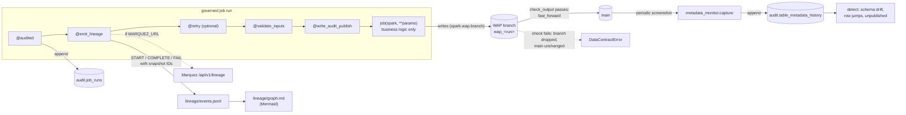

# Iceberg Lineage Lab

A small, runnable PySpark 4 + Apache Iceberg 1.10 project that shows how I would
govern automated Spark jobs on a lakehouse. Every job goes through one
`@governed_job` decorator, built from small composable decorators: it checks input
contracts, writes to a private Iceberg branch, audits that branch (keys, raw
PII), and only then publishes to `main` (Write-Audit-Publish). Each run emits
OpenLineage events that carry the exact Iceberg snapshot IDs it read and wrote,
and appends a row to an append-only audit log with the git SHA of the code. A
metadata monitor takes periodic "screenshots" of each table's Iceberg metadata to
catch schema drift, row-count jumps and unpublished snapshots, and the changelog
view gives row-level changes. Everything runs locally with no Docker: a Hadoop
catalog in `warehouse/`. Marquez is optional.

## One demo per interview question

| Interview question | Demo command | Code (file:function) |
| --- | --- | --- |
| Q1 Do you know Iceberg? | `python -m lab.show q1` | `jobs/positions.py:create_tables` (hidden partitioning); Iceberg metadata tables; `lab/show.py:scan` (scan metrics) |
| Q2 Do you know data lineage? | `python -m lab.show q2` | `lab/lineage.py:provenance`, `downstream`; `lab/decorators.py:emit_lineage` |
| Q3 How would you implement data lineage? | `python -m lab.show q3` | `lab/lineage.py:emit`, `post_to_marquez`, `to_mermaid`, `write_graph`; `docker-compose.yml` |
| Q4 Integrity and compliance while automating Spark jobs? | `python -m lab.show q4` | `lab/decorators.py:governed_job`, `write_audit_publish`, `audited`; `lab/contracts.py:check_inputs`, `check_output`; `lab/audit.py:record`; `lab/compliance.py:hash_pii`, `erase`; `jobs/positions.py:publish_trades`, `erase_client` |
| Q5 Do you know decorators? | `python -m lab.show q5` | `lab/decorators.py:_layer`, `layers`; `lab/show.py:demo` |
| Q6 Decorators for integrity and encapsulation? | `python -m lab.show q6` | `lab/decorators.py:retry`, `validate_inputs`, `write_audit_publish`, `emit_lineage`, `audited`, `governed_job` |
| Q7 How do you capture changes in a pipeline? | `python -m lab.show q7` | `lab/metadata_monitor.py:capture`, `detect`, `unpublished`; `lab/cdc.py:changes_between`, `incremental_appends`, `SnapshotWatcher` |

`python -m lab.show all` runs all seven. Each demo starts from an empty warehouse.
[docs/interview_walkthrough.md](docs/interview_walkthrough.md) has a short
spoken answer for each question and what to point at in the output.

## Architecture



## Quickstart

Requires Python 3.10+ and Java 17 or 21 (`sudo apt install openjdk-17-jdk`).

```bash
python3 -m venv .venv && source .venv/bin/activate
pip install -r requirements.txt
pytest -q                     # 16 tests
python -m lab.show q4         # or q1..q7, or all
python demo.py                # the original end-to-end walkthrough
```

Spark logs go to stderr. Add `2>/dev/null` for clean demo output.

The first run downloads the Iceberg runtime jar (~47 MB) from Maven Central. On a
network that blocks Spark's downloader, fetch it yourself:

```bash
curl -fLo iceberg.jar https://repo1.maven.org/maven2/org/apache/iceberg/iceberg-spark-runtime-4.0_2.13/1.10.0/iceberg-spark-runtime-4.0_2.13-1.10.0.jar
ICEBERG_JAR=$PWD/iceberg.jar python -m lab.show all
```

Optional lineage UI (needs Docker and a few GB of free RAM):

```bash
docker compose up -d
MARQUEZ_URL=http://localhost:5000 python -m lab.show q3
# open http://localhost:3000, namespace "iceberg-lineage-lab"
docker compose down
```

Run the metadata monitor on a schedule:

```bash
python -m lab.metadata_monitor --every 60 raw.trades curated.positions
```

## Benchmark

```bash
python bench.py --rows 5000000 --days 30 2>/dev/null
```

`bench.py` generates synthetic trades inside Spark (5,000 accounts, 200 tickers,
fixed seed) in its own `bench_warehouse/`, then times the real `build_positions`
job with and without its decorators, a one-day query, and the changelog of one
incremental MERGE. Each timing is the second of two runs. This is a single-laptop,
Spark local-mode run (`local[2]`, 1 GB default driver memory) on synthetic data, not
a cluster measurement. Result of one run with 5,000,000 rows:

| Metric | Value |
| --- | --- |
| Input trades (raw.trades) | 5000000 |
| Days / data files in raw.trades | 30 / 30 |
| Output positions (curated.positions) | 993255 |
| Governed build_positions, 2nd run (s) | 9.36 |
| Governed throughput (input rows/s) | 534,324 |
| Bare MERGE without decorators, 2nd run (s) | 6.34 |
| Governance overhead | 47.5% |
| One-day filter: data files read / total | 1 / 30 |
| One-day filter: skippedDataFiles metric | 29 |
| Extra day appended (trades) | 166666 |
| Governed incremental MERGE (s) | 16.38 |
| Changelog rows: INSERT | 993 |
| Changelog rows: UPDATE_AFTER | 152543 |
| Changelog rows: UPDATE_BEFORE | 152543 |
| Rows in curated.positions after MERGE | 994248 |
| Total script time (s) | 80.40 |

Machine: Intel Core i7-1065G7 @ 1.30GHz, 8 logical cores, 11.5 GiB RAM, Linux 6.8;
Spark 4.0.1, `master=local[2]`, `shuffle.partitions=2`. The governed time includes
everything the decorators add: the input contract check, creating and dropping the
WAP branch, the null and duplicate-key checks on the branch, the fast-forward, the
audit row and the lineage events. The benchmark does not break that down further.
Timings vary from run to run with machine load.

## Layout

| File | What it does |
| --- | --- |
| `lab/decorators.py` | `validate_inputs`, `write_audit_publish`, `emit_lineage`, `audited`, `retry`, and `governed_job` composed from them |
| `lab/contracts.py` | `DataContractError`, input and output checks, `current_snapshot` |
| `lab/governance.py` | Old import path for `governed_job` and the checks |
| `lab/audit.py` | Append-only `audit.job_runs`; git SHA of the running code |
| `lab/compliance.py` | Salted SHA-256 pseudonymisation; erasure plus snapshot expiry |
| `lab/lineage.py` | OpenLineage events, Marquez POST, Mermaid graph, provenance, impact analysis |
| `lab/metadata_monitor.py` | Periodic metadata screenshots and alerts |
| `lab/cdc.py` | Changelog view, incremental read, `SnapshotWatcher` with a checkpoint |
| `lab/show.py` | The `q1`..`q7` demos |
| `jobs/positions.py` | Example tables and jobs: positions (MERGE), curated trades (PII hashed), erasure |
| `demo.py` | Original end-to-end walkthrough |

## Design choices and trade-offs

**Write-Audit-Publish instead of checks after the write.** If you check after
writing to `main`, readers can see bad data before the check fails, and you then
need a rollback. With WAP, the job writes to a branch nobody reads, the checks run
on that branch, and `main` moves with one atomic `fast_forward`. The cost is one
extra metadata commit and the checks' scan of the branch. One more detail:
`write_audit_publish` creates the branch from `main` itself. If the first WAP write
creates the branch, Iceberg 1.10 computes the snapshot's `total-records` and
`total-data-files` from zero, which gave the metadata monitor wrong row counts.
`tests/test_monitor.py` covers this.

**Changelog view vs incremental read.** `start-snapshot-id` reads only the files
added by `append` snapshots. `MERGE`, `UPDATE` and `DELETE` commit `overwrite`
snapshots, so an incremental read silently returns nothing for them (q7 shows 0
rows). `create_changelog_view` compares removed and added files and returns
`INSERT`, `DELETE`, `UPDATE_BEFORE` and `UPDATE_AFTER`, at the cost of reading
both sides. Use incremental reads for append-only tables like `raw.trades`, and the
changelog view for anything that is merged into.

**At-least-once checkpointing.** `SnapshotWatcher` writes its checkpoint only after
the handler succeeds. A crash between the two replays that batch instead of losing
it, so handlers must be idempotent (MERGE on a key). Exactly-once needs the
checkpoint and the output in one commit, which Iceberg cannot do across tables.

**Idempotent reruns.** `@audited` skips a `run_key` that already has a `SUCCESS`
row, and the WAP key check rejects duplicates if someone bypasses that. Because the
audit row is written after the publish, there is a small window (publish
succeeded, audit write failed) where a rerun would run again. The WAP duplicate
check catches that for keyed tables. A stricter design records the run key in the
snapshot summary itself (`snapshot-property.*` or `spark.wap.id` with
`cherrypick_snapshot`, which refuses to publish the same WAP ID twice).

**Snapshot expiry vs time travel.** Time travel and rollback only work while old
snapshots exist, and old snapshots keep old data files on disk. That conflicts
with erasure: after a `DELETE`, the person's rows are still readable with
`VERSION AS OF`. `erase` therefore expires every older snapshot right away, which
also gives up time travel on that table from that point. It refuses to run while
other branches or tags exist, because they would keep the old files alive. It
relies on copy-on-write deletes, the default here. With merge-on-read, the old
data file stays referenced until compaction (`rewrite_data_files`) runs. In
production you would set a retention policy (for example 7 days of snapshots) and
run erasure as a scheduled, audited job.

**Why schema changes are not branch-scoped.** In Iceberg, a branch is a pointer to
a snapshot, but the schema belongs to the table metadata that all branches share.
`ALTER TABLE` changes the schema for `main` immediately, even when it runs inside
a WAP job, and it creates no snapshot. So WAP guards data, not schema. Schema
changes need their own review (migrations in version control), and the metadata
monitor hashes the schema at every screenshot to catch drift that snapshot IDs
alone would miss.

**Pseudonymisation, not anonymisation.** `client_name_sha256` is a salted hash: it
still joins, it cannot be reversed, and guessing names by hashing
candidates needs the salt. Under GDPR it is still
personal data, so `erase_client` deletes it too. The salt comes from `PII_SALT`
and is a platform secret. Job authors never see it.

**Lineage is observability, not a gate.** If Marquez is down, the job still runs,
a warning is logged, and the event is still in `events.jsonl`. Input snapshot IDs
are read when the run starts. Pinning the job's reads to those snapshots
(`VERSION AS OF`) would make the lineage exact even if inputs change mid-run.

## Limitations

- Local Hadoop catalog only. Real deployments would use a REST, Glue or Nessie
  catalog with access control, which is where "INSERT only" on the audit table is
  enforced.
- WAP covers one output table per job.
- Lineage is table-level. Column-level lineage would come from the OpenLineage Spark listener.
